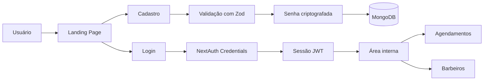

# Fullstack Next Web2

Aplicação fullstack em Next.js para uma barbearia, com landing page, autenticação de usuários e estrutura inicial para gerenciamento de barbeiros e agendamentos.

O projeto usa o App Router do Next.js, autenticação com NextAuth, validação de formulários com Zod + React Hook Form e persistência de dados com MongoDB via Mongoose.

## Funcionalidades

- Landing page com animações e identidade visual de barbearia.
- Cadastro de usuários com definição de perfil: `client` ou `barber`.
- Login com credenciais usando NextAuth.
- Criptografia de senhas com `bcryptjs`.
- Página interna `/home` com área para agendamentos e barbeiros cadastrados.
- Modelos MongoDB para usuários e barbeiros.
- Componentes reutilizáveis com Tailwind CSS, shadcn/ui, Radix UI e Lucide React.

## Tecnologias

- Next.js 16
- React 19
- TypeScript
- Tailwind CSS 4
- NextAuth
- MongoDB + Mongoose
- Zod
- React Hook Form
- bcryptjs
- Framer Motion / Motion
- Three.js, React Three Fiber e Drei
- shadcn/ui e Radix UI

## Estrutura Principal

```text
src/
  app/
    api/
      auth/[...nextauth]/route.ts
      login/route.ts
      register/route.ts
    home/page.tsx
    login/
    register/
    signup/
    perfil/
    page.tsx
  components/
  hooks/
  lib/
    auth.ts
    db.ts
    utils.ts
  models/
    Barbeiro.ts
    Usuario.ts
    Agendamento.ts
```

## Como Rodar o Projeto

### 1. Clone o repositório

```bash
git clone https://github.com/Arthurms02/fullstack_next_web2.git
cd fullstack_next_web2
```

### 2. Instale as dependências

```bash
npm install
```

### 3. Configure as variáveis de ambiente

Crie um arquivo `.env.local` na raiz do projeto:

```env
MONGODB_URI=sua_string_de_conexao_mongodb
NEXTAUTH_SECRET=sua_chave_secreta
NEXTAUTH_URL=http://localhost:3000
```

Para gerar uma chave segura para `NEXTAUTH_SECRET`, você pode usar:

```bash
openssl rand -base64 32
```

### 4. Inicie o servidor de desenvolvimento

```bash
npm run dev
```

Acesse:

```text
http://localhost:3000
```

## Scripts Disponíveis

```bash
npm run dev
```

Inicia o projeto em modo de desenvolvimento.

```bash
npm run build
```

Gera a versão de produção.

```bash
npm run start
```

Executa a versão de produção após o build.

```bash
npm run lint
```

Executa a verificação de lint do projeto.

## Rotas

| Rota | Descrição |
| --- | --- |
| `/` | Landing page do projeto |
| `/home` | Página interna com agendamentos e barbeiros |
| `/login` | Tela de login |
| `/register` | Tela de cadastro |
| `/signup` | Tela adicional de cadastro |
| `/perfil` | Página de perfil |
| `/api/register` | Endpoint para registro de usuário |
| `/api/login` | Endpoint inicial para login |
| `/api/auth/[...nextauth]` | Rotas do NextAuth |

## Banco de Dados

O projeto utiliza MongoDB com Mongoose. O modelo principal de usuário possui:

- `name`
- `email`
- `password`
- `role`
- `createdAt`
- `updatedAt`

O campo `role` aceita os valores:

- `client`
- `barber`

Também existe um modelo de barbeiro com dados como nome, email, senha, nome do estabelecimento e CPF.

## Fluxo Simplificado



## Observações

- A conexão com o banco depende da variável `MONGODB_URI`.
- O login principal é feito pelo NextAuth usando o provider de credenciais.
- Algumas áreas, como agendamentos e listagem real de barbeiros, ainda estão em estrutura inicial e podem ser evoluídas.